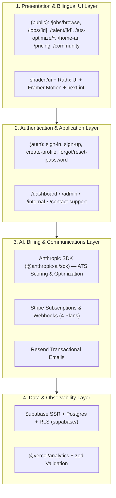

# BidJob (`bidjobsup`) — AI-Powered Talent Bidding, ATS Optimization & Hiring Marketplace

A full-stack Next.js 16, Supabase, Anthropic AI, and Stripe marketplace connecting employers and job seekers through competitive bidding, AI-powered ATS resume optimization, bilingual (EN/AR) workflows, and tiered SaaS subscriptions.

---

## 1. Executive Summary & Purpose
`bidjobsup` (`bidjob`) reimagines recruitment as a transparent, AI-assisted marketplace. Job seekers optimize their CVs against Applicant Tracking Systems (`/ats-optimize`) and bid on opportunities, while employers browse vetted talent (`/talent`), manage listings, and subscribe to multi-tier plans (`SEEKER_ELITE`, `EMPLOYER_PRO`, `EMPLOYER_VISIONARY`, `EMPLOYER_NEXUS`) via Stripe.

---

## 2. System Architecture & Layers



| Layer | Responsibility | Key Modules |
| :--- | :--- | :--- |
| **Presentation & i18n Layer** | Public job marketplace, talent profiles, Arabic landing (`/home-ar`), blog, and Framer Motion UI | `app/(public)/*`, `locales/`, `components/` |
| **ATS Optimization Layer** | Single & batch resume analysis, interactive editor, and optimization results | `app/(public)/ats-optimize/{page,editor,results,batch}/page.tsx` |
| **Auth & Onboarding Layer** | Supabase SSR auth flows and mandatory profile completion | `app/(auth)/{sign-in,sign-up,create-profile,forgot-password,reset-password}/page.tsx` |
| **SaaS Billing & AI Layer** | Tiered Stripe plans (`SEEKER_ELITE`, `EMPLOYER_PRO/VISIONARY/NEXUS`), Anthropic AI calls, Resend emails | `app/api/`, `lib/`, `.env.example` |
| **Data & Governance Layer** | Postgres schema/RLS (`supabase/`), typed auth guards, and Vercel Analytics | `supabase/`, `lib/supabase/`, `app/{admin,internal}/` |

---

## 3. Core Functionality & Modules
- **AI ATS Resume Optimizer (`/ats-optimize`)**: Upload/edit resumes (`/ats-optimize/editor`), review keyword/score results (`/ats-optimize/results`), and run bulk candidate screening (`/ats-optimize/batch`).
- **Job Marketplace & Discovery (`/jobs/browse`, `/jobs/list`, `/jobs/search`, `/jobs/[id]`)**: Multi-facet filtering (`FilterSidebar.tsx`), sorting (`SortSelect.tsx`), and direct job bidding.
- **Talent Directory (`/talent`, `/talent/[id]`)**: Searchable talent profiles for employers.
- **Community & Content (`/community`, `/blog`, `/join`, `/pricing`)**: User engagement, industry articles, and transparent subscription tiers.
- **Admin & Support (`/admin`, `/internal`, `/contact-support`)**: Internal moderation, support ticketing via Resend, and operational tooling.

---

## 4. Project Structure
```text
├── app/
│   ├── (auth)/           # Sign-in, sign-up, create-profile, password reset
│   ├── (public)/         # jobs/, talent/, ats-optimize/, blog/, community/, home-ar/, pricing/
│   ├── admin/            # Platform administration
│   ├── api/              # Stripe webhooks, AI endpoints, auth handlers
│   ├── dashboard/        # Seeker & employer dashboards
│   └── internal/         # Internal operational views
├── components/           # shadcn/ui & domain components
├── lib/                  # Supabase, error handling, auth helpers
├── locales/              # i18n translation dictionaries
├── supabase/             # Database migrations & policies
└── docs/                 # Architecture documentation
```

---

## 5. Getting Started

```bash
git clone https://github.com/islamsamyy/bidjobsup.git
cd bidjobsup
npm install
cp .env.example .env.local
```

**Required Environment Variables**:
- `NEXT_PUBLIC_SUPABASE_URL`, `NEXT_PUBLIC_SUPABASE_ANON_KEY`
- `NEXT_PUBLIC_STRIPE_PUBLISHABLE_KEY`, `STRIPE_SECRET_KEY`, `STRIPE_WEBHOOK_SECRET`
- `STRIPE_PRICE_SEEKER_ELITE`, `STRIPE_PRICE_EMPLOYER_PRO`, `STRIPE_PRICE_EMPLOYER_VISIONARY`, `STRIPE_PRICE_EMPLOYER_NEXUS`
- `RESEND_API_KEY`, `EMAIL_FROM`, `CONTACT_SUPPORT_EMAIL`, `NEXT_PUBLIC_SITE_URL`

| Script | Description |
| :--- | :--- |
| `npm run dev` | Start Next.js 16 dev server |
| `npm run build` | Build production bundle |
| `npm run lint` | Run ESLint |

---

## 6. Business Value & Growth Opportunities
- **Dual-Sided Recurring Revenue**: Monetizes both sides of the market—job seekers via `SEEKER_ELITE` (ATS AI credits & priority bids) and employers via 3 progressive B2B tiers (`PRO`, `VISIONARY`, `NEXUS`).
- **MENA Bilingual Wedge (`/home-ar`)**: Combining Arabic-first localization with AI ATS optimization differentiates BidJobs from generic Western job boards.
- **B2B Recruitment Agency Licensing**: Offer `/ats-optimize/batch` as a standalone API or seat-based tool for HR agencies screening hundreds of CVs daily.
- **Escrow & Milestone Payouts**: Add Stripe Connect escrow for freelance/contract engagements won through bidding.
