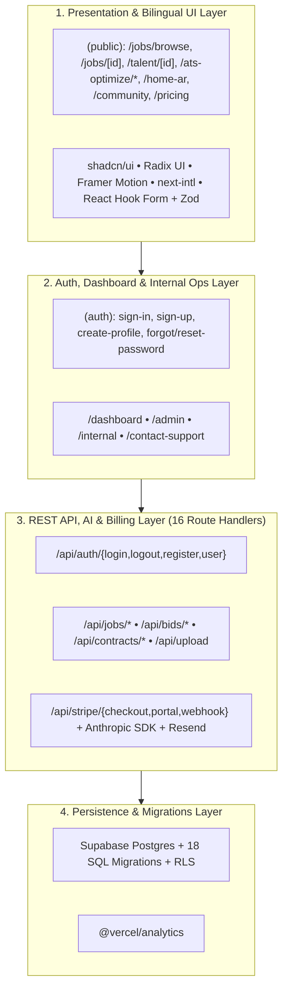
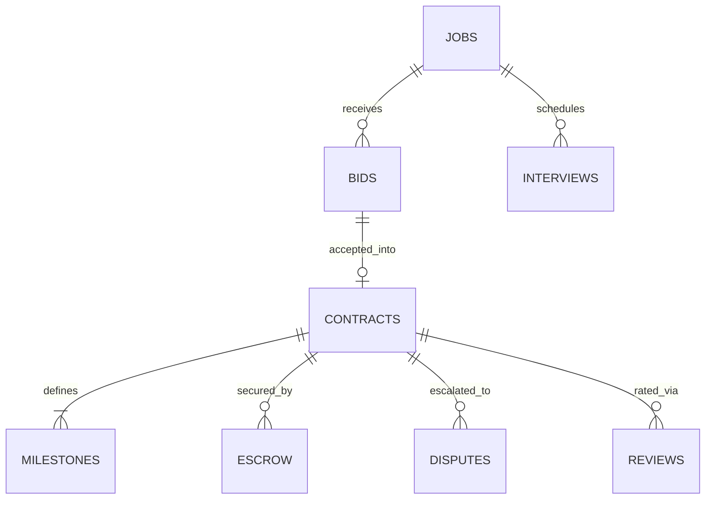

# BidJob (`bidjobsup`) — AI-Powered Talent Bidding, ATS Optimization & Hiring Marketplace

<p align="center">
  
</p>

## Table of Contents
- [Executive Summary & Business Utility](#executive-summary--business-utility)
- [Visual Showcase (UI & Dashboards)](#visual-showcase-ui--dashboards)
- [System Architecture & Layers](#system-architecture--layers)
- [Data Model & Marketplace Mechanics](#data-model--marketplace-mechanics)
- [Database Schema, Migrations & RLS](#database-schema-migrations--rls)
- [Application Modules & API Endpoints](#application-modules--api-endpoints)
- [Getting Started & Scripts](#getting-started--scripts)
- [Business Value, ROI & Growth Opportunities](#business-value-roi--growth-opportunities)

---

## Executive Summary & Business Utility
`bidjobsup` (`bidjob`) is a full-stack Next.js 16, Supabase, Anthropic AI, Resend, and Stripe talent marketplace. It combines **competitive job bidding, AI-powered ATS resume optimization (`/ats-optimize`), milestone contracts & escrow, dispute resolution, community networking, and bilingual (EN/AR) support (`/home-ar`)** into a unified hiring ecosystem powered by 4 progressive Stripe subscription tiers (`SEEKER_ELITE`, `EMPLOYER_PRO`, `EMPLOYER_VISIONARY`, `EMPLOYER_NEXUS`).

---

## Visual Showcase (UI & Dashboards)
Brand identity and UI iconography assets stored in `public/`:

| Brand Logo | Platform Architecture |
| :---: | :---: |
|  | Next.js 16 App Router • Supabase SSR • Anthropic AI • Stripe Connect/Billing |

---

## System Architecture & Layers



| Layer | Responsibility | Key Files |
| :--- | :--- | :--- |
| **Presentation & i18n Layer** | Job search/browse, talent discovery, Arabic landing (`/home-ar`), community feed, and pricing | `app/(public)/*`, `locales/`, `components/` |
| **AI ATS Optimization Layer** | Single resume editor, keyword/score results, and batch screening | `app/(public)/ats-optimize/{page,editor,results,batch}/page.tsx` |
| **REST API Layer** | 16 route handlers covering auth, jobs, bids, contract acceptance, Stripe billing, and file uploads | `app/api/{auth,bids,contracts,jobs,stripe,upload}/**/route.ts` |
| **AI, Payments & Email Layer** | `@anthropic-ai/sdk` analysis, Stripe subscription webhooks, and Resend transactional emails | `app/api/stripe/*`, `.env.example` |
| **Database & Governance Layer** | 18 SQL migrations covering jobs, bids, contracts, escrow, disputes, interviews, skills, and community | `supabase/migrations/*.sql`, `app/{admin,internal}/` |

---

## Data Model & Marketplace Mechanics


---

## Database Schema, Migrations & RLS
18 SQL migrations in `supabase/migrations/` (including `20260408_*`, `20260409_*`) provision a complete enterprise marketplace schema:

| Domain | Tables |
| :--- | :--- |
| **Marketplace & Bidding** | `jobs`, `bids`, `invitations`, `offers`, `offer_notes`, `interviews`, `interview_notes` |
| **Contracts, Escrow & Billing** | `contracts`, `milestones`, `payments`, `escrow`, `invoices`, `payment_receipts` |
| **Trust & Disputes** | `disputes`, `dispute_evidence`, `dispute_messages`, `reviews`, `reports` |
| **AI & Talent Profiles** | `ats_analysis_history`, `portfolio_items`, `skills`, `skill_categories`, `skill_endorsements`, `skill_verifications` |
| **Community & Support** | `community_posts`, `community_post_likes`, `community_post_comments`, `profile_posts`, `post_likes`, `post_comments`, `comment_likes`, `saved_posts`, `post_mentions`, `contact_messages` |

---

## Application Modules & API Endpoints

| Route | Purpose |
| :--- | :--- |
| `/api/auth/{login,logout,register,user}` | Session authentication & user state |
| `/api/jobs`, `/api/jobs/[id]`, `/api/jobs/[id]/bids` | Job CRUD & job-scoped bid listing |
| `/api/bids`, `/api/bids/[id]`, `/api/bids/[id]/accept` | Bid submission, updates & contract creation |
| `/api/contracts`, `/api/contracts/[id]` | Active contract & milestone management |
| `/api/stripe/{checkout,portal,webhook}` | Subscription checkout, customer portal & webhook sync |
| `/api/upload` | Resume & portfolio asset upload |

---

## Getting Started & Scripts

```bash
git clone https://github.com/islamsamyy/bidjobsup.git
cd bidjobsup
npm install
cp .env.example .env.local
npm run dev
```

**Environment Variables (`.env.example`)**: `NEXT_PUBLIC_SUPABASE_URL`, `NEXT_PUBLIC_SUPABASE_ANON_KEY`, `NEXT_PUBLIC_STRIPE_PUBLISHABLE_KEY`, `STRIPE_SECRET_KEY`, `STRIPE_WEBHOOK_SECRET`, `STRIPE_PRICE_SEEKER_ELITE`, `STRIPE_PRICE_EMPLOYER_PRO`, `STRIPE_PRICE_EMPLOYER_VISIONARY`, `STRIPE_PRICE_EMPLOYER_NEXUS`, `RESEND_API_KEY`, `EMAIL_FROM`, `CONTACT_SUPPORT_EMAIL`, `NEXT_PUBLIC_SITE_URL`.

---

## Business Value, ROI & Growth Opportunities
- **Multi-Stream Monetization**: Combines recurring SaaS subscriptions (4 Stripe tiers), escrow transaction fees on `contracts`/`milestones`, and AI ATS optimization credits (`ats_analysis_history`).
- **MENA + Global Arbitrage**: Arabic-first onboarding (`/home-ar`) + AI CV optimization positions BidJobs to capture high-growth MENA remote talent and GCC employers.
- **Enterprise HR API**: Expose `/ats-optimize/batch` as a metered B2B API for enterprise recruitment teams.
